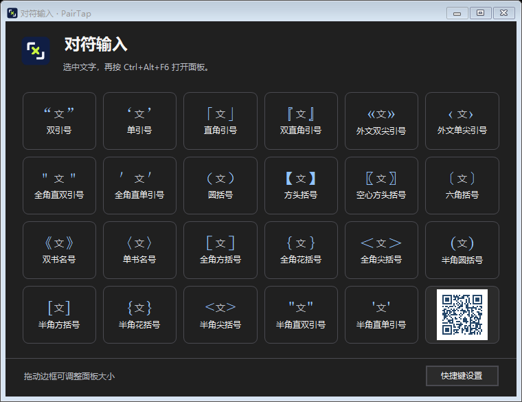

# PairTap

Wrap selected text in matching quotes, brackets, and title marks with a single shortcut on Windows.

[Download PairTap.exe (Portable)](https://github.com/Buds-2025/PairTap/releases/latest/download/PairTap.exe) · [简体中文](README.md) · [Releases](https://github.com/Buds-2025/PairTap/releases/latest)

---

## How to Use

1. **Run**: Download and run `PairTap.exe` (portable single-file, sits in the system tray).
2. **Select**: Highlight text in an editable area in Word, a text editor, or a browser.
3. **Wrap**:
   - Press a **shortcut** (e.g. `Ctrl+Shift+'` for double quotes);
   - Or press `Ctrl+Alt+F6` to pick a pair from the visual panel.

---

## Default Shortcuts

Add `Ctrl` to your normal punctuation keystroke to wrap the selected text:

| Selection | Shortcut | Chinese Marks | Half-Width Marks |
| :--- | :--- | :--- | :--- |
| check later | `Ctrl+Shift+'` | `“check later”` | `"check later"` |
| original | `Ctrl+'` | `‘original’` | `'original'` |
| optional | `Ctrl+Shift+9` or `Ctrl+Shift+0` | `（optional）` | `(optional)` |
| pending | `Ctrl+[` or `Ctrl+]` | `【pending】` | `[pending]` |
| note | `Ctrl+Shift+[` or `Ctrl+Shift+]` | `「note」` | `{note}` |
| The Little Prince | `Ctrl+Shift+,` or `Ctrl+Shift+.` | `《The Little Prince》` | `<The Little Prince>` |

> **Tips**:
> - Press `Ctrl+Alt+F6` to choose from all 23 matching pairs.
> - Click the tray icon to view the punctuation panel. Right-click and choose Shortcut Settings to customize shortcuts or lock output to Chinese marks.
> - In Word documents and tables, PairTap inserts delimiters around the selection, preserving its formatting. A single undo removes both delimiters.
> - If the clipboard is busy or an editor blocks copying, the same shortcut inserts delimiters directly when it can verify both ends of the selection. If a paste was sent without changing a verifiable selection, the notification asks you to press the same shortcut again.
> - Clipboard-free wrapping needs an editor that exposes readable text and precise selection boundaries. PairTap stops writing when it detects a focus or content change. Check the original editor if a notification reports an unconfirmed result.
> - The runtime log at `%LOCALAPPDATA%\PairTap\Logs\runtime.log` records the application process name, write method, stage, timing, and result. It omits document names, selected text, and clipboard content.

To build and run release checks, exit PairTap and Word, then run `pwsh -File VerifyRelease.ps1` from an interactive Windows session with Chrome, Word, and PowerShell 7 installed. Use `-Quick` to check the build, version, checksum, and recovery from stalled editors and clipboard reads. Use `-SettingsOnly` to test shortcut conflicts, saving, and persistence across a restart. This mode restores the original shortcut settings when it finishes. Use `-RequireMixedDpi` when two active displays use different DPI settings, or `-Artifact` with `-RequireSignature` to check a signed release binary.
