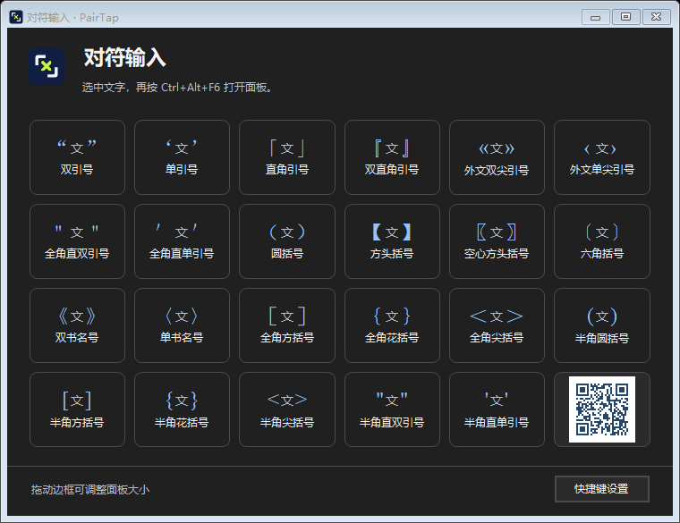

# PairTap — Add quotes and brackets around selected text on Windows

**PairTap (对符输入)** is a portable Windows tray utility that wraps existing text in matching punctuation with one keyboard shortcut. Select `check later` in a message and turn it into `"check later"`, `“check later”`, or `(check later)` in place.

[Download PairTap.exe](https://github.com/Buds-2025/PairTap/releases/latest/download/PairTap.exe) · [简体中文](README.md) · [Release notes and SHA-256](https://github.com/Buds-2025/PairTap/releases/latest)

## Quick start

1. Run the downloaded `PairTap.exe`. The PairTap icon appears in the Windows system tray.
2. Select existing text in an editor or web input, then press `Ctrl+Alt+F6` to open the punctuation panel.
3. Click a pair to add one mark at each end of the selection.

The portable edition runs without installation. It has been tested on Windows 11 x64. The executable is currently unsigned, and the app interface is in Simplified Chinese.

## Keyboard shortcuts for quotes and brackets

On a US keyboard layout, add Ctrl to the keystroke you already use to type the punctuation mark. For example, `Shift+'` types a double quote. `Ctrl+Shift+'` wraps the selection in a pair of double quotes.

| Selection | Default shortcut | Chinese punctuation | Half-width punctuation |
| --- | --- | --- | --- |
| check later | `Ctrl+Shift+'` | `“check later”` | `"check later"` |
| original | `Ctrl+'` | `‘original’` | `'original'` |
| optional | `Ctrl+Shift+9` or `Ctrl+Shift+0` | `（optional）` | `(optional)` |
| pending | `Ctrl+[` or `Ctrl+]` | `【pending】` | `[pending]` |
| note | `Ctrl+Shift+[` or `Ctrl+Shift+]` | `「note」` | `{note}` |
| 小王子 | `Ctrl+Shift+,` or `Ctrl+Shift+.` | `《小王子》` | `<小王子>` |

The punctuation panel contains **23 pairs**.

| Category | Available pairs |
| --- | --- |
| Quotation marks | `“ ”`, `‘ ’`, `「 」`, `『 』`, `« »`, `‹ ›`, `＂ ＂`, `＇ ＇` |
| Chinese brackets and book title marks | `（ ）`, `【 】`, `〖 〗`, `〔 〕`, `《 》`, `〈 〉`, `［ ］`, `｛ ｝`, `＜ ＞` |
| Half-width punctuation | `( )`, `[ ]`, `{ }`, `< >`, `" "`, `' '` |

## FAQ

### How do I always get the same quotation marks or change a shortcut?

Open **快捷键设置** (Shortcut Settings) from the tray menu or the bottom right of the panel. You can bind a shortcut to a specific pair, change or clear a binding, or restore the defaults. Preferences are stored for the current Windows user and carry over when you replace the portable executable.

Direct shortcuts use the keyboard layout and input method state exposed by Windows. Microsoft Pinyin's separate Chinese/English punctuation switch may change without an update to the state Windows reports. Choose a fixed Chinese, half-width, or full-width style, or bind a shortcut to the exact pair you want. If a shortcut conflicts with an existing app command, reassign it in PairTap.

### Does it work in Word or a browser? Does it preserve formatting?

PairTap has been tested with native text fields and Chrome web inputs on Windows 11 x64. Support in Word and other editors depends on whether the active field exposes a verifiable editable selection and allows plain-text copy and paste. To check a particular field, select a short sample and try a pair from the panel.

PairTap can edit standard Windows text fields directly. Other fields may use the clipboard path, which **can strip rich formatting such as bold or color inside the selection**. Password fields, read-only fields, and elevated windows may be restricted. PairTap stops if it cannot safely back up the clipboard contents.

### How do I switch from the old installer to the portable edition?

Quit the running copy from the tray, then open the downloaded `PairTap.exe`. To remove the old installation, uninstall it from **Settings → Apps → Installed apps** before starting the portable copy.

## Why PairTap exists

Typing a pair of quotes before writing is easy. Adding quotes to text that is already there usually means moving the caret to both ends, or cutting the text and pasting it back between the marks. That comes up in documents, forms, and messages.

Word macros can help in some cases, and Quicker offers a punctuation pairing action called 超级对符. With AI available, I wanted to try building a small Windows utility of my own and make the whole operation a single keystroke. [Quicker's 超级对符 action](https://www.getquicker.net/Sharedaction?code=0cf35569-18d3-4ac6-99bf-08dcff9008ea)

## Build and report issues

On Windows 11 x64, run `.\Build.ps1` from the repository root. The script uses the .NET Framework compiler on Windows and produces `dist\PairTap.exe` by default.

When reporting an issue, include your Windows version, target app, input method, shortcut, and the expected and actual text. [Report an issue](https://github.com/Buds-2025/PairTap/issues/new)
