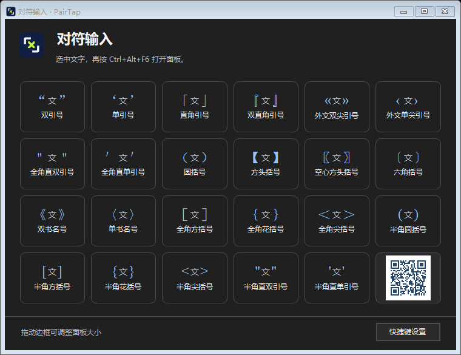

# 对符输入 PairTap

**在 Windows 上选中文字，一次加上两边的引号、括号或书名号。** 比如，消息里的「稍后确认」已经打好了，选中这四个字，按一次快捷键就能得到 `“稍后确认”`。

[下载 PairTap.exe（便携版）](https://github.com/Buds-2025/PairTap/releases/latest/download/PairTap.exe) · [English](README.en.md) · [版本记录与 SHA-256](https://github.com/Buds-2025/PairTap/releases/latest)

## 30 秒上手

1. 双击下载的 `PairTap.exe`。看到系统托盘里的对符输入图标，就可以使用。
2. 在编辑器或网页输入框里选中已有文字，按 `Ctrl+Alt+F6` 打开标点面板。
3. 点选要加的符号。PairTap 会把两个符号分别放到选区的开头和结尾。

便携版无需安装。已在 Windows 11 x64 上测试，当前发布的可执行文件未做代码签名。

## 直接用快捷键加标点

常用对符有直达键。在美式键盘上，按原本用来输入标点的组合键，再加一个 Ctrl。比如，平时按 `Shift+'` 输入双引号，用 PairTap 时按 `Ctrl+Shift+'`，一次加上前后两边。

| 选中的文字 | 默认快捷键 | 中文标点 | 半角标点 |
| --- | --- | --- | --- |
| 稍后确认 | `Ctrl+Shift+'` | `“稍后确认”` | `"稍后确认"` |
| 原文 | `Ctrl+'` | `‘原文’` | `'原文'` |
| 可选 | `Ctrl+Shift+9` 或 `Ctrl+Shift+0` | `（可选）` | `(可选)` |
| 待处理 | `Ctrl+[` 或 `Ctrl+]` | `【待处理】` | `[待处理]` |
| 备注 | `Ctrl+Shift+[` 或 `Ctrl+Shift+]` | `「备注」` | `{备注}` |
| 小王子 | `Ctrl+Shift+,` 或 `Ctrl+Shift+.` | `《小王子》` | `<小王子>` |

打开标点面板可选用全部 **23 组成对符号**。

| 分类 | 支持的符号 |
| --- | --- |
| 引号 | `“ ”`、`‘ ’`、`「 」`、`『 』`、`« »`、`‹ ›`、`＂ ＂`、`＇ ＇` |
| 中文括号与书名号 | `（ ）`、`【 】`、`〖 〗`、`〔 〕`、`《 》`、`〈 〉`、`［ ］`、`｛ ｝`、`＜ ＞` |
| 半角符号 | `( )`、`[ ]`、`{ }`、`< >`、`" "`、`' '` |

## 常见问题

### 想固定用中文引号，或遇到快捷键冲突，怎么设置？

在托盘右键菜单或面板右下角打开「快捷键设置」。可以给指定符号单独设键，也可以改动、清除或恢复默认绑定。设置保存在当前 Windows 用户下，更新便携版后可以继续使用。

直达键默认根据 Windows 提供的键盘布局和输入法状态选择标点。微软拼音单独切换中英文标点时，Windows 读出的状态可能没有同步变化。需要每次都得到 `“ ”` 时，可以选「固定中文标点」，或为这组引号单独绑定快捷键。若某个应用已经占用了同一组按键，在 PairTap 中换一组即可。

### 在 Word、浏览器或其他编辑器里能用吗？原格式会保留吗？

PairTap 在 Windows 11 x64 的原生文本框和 Chrome 网页输入框上做过实测。Word 和其他编辑器的可用性取决于当前控件能否提供可验证的可编辑选区，以及是否允许复制、粘贴纯文本。想确认某个输入框是否可用，可以选一小段文字，再通过面板加一组标点。

标准 Windows 文本框可直接替换选区。其他控件可能通过剪贴板处理，**选区内的粗体、颜色等富文本格式可能丢失**。密码框、只读控件和管理员权限窗口可能受限。剪贴板内容无法安全备份时，PairTap 会停止操作。

### 已经装过安装版，怎么换成便携版？

先从系统托盘退出正在运行的 PairTap，再双击新下载的 `PairTap.exe`。想清理旧安装，可以在 Windows「设置 → 应用 → 已安装的应用」中卸载旧版，再启动便携版。

## 为什么做这个工具？

给还没写的文字加引号很顺手。要给已经写好的文字补引号，往往得把光标移到两端分别输入，或者先剪切，再把文字粘贴到两枚符号之间。编辑文档、填表或回消息时，常常只差这两个符号。

Word 宏能解决一部分场景，Quicker 也有「超级对符」动作。既然有了 AI，我还是想自己做一个 Windows 小工具，试试看能不能把这几步变成一次按键。 [Quicker「超级对符」](https://www.getquicker.net/Sharedaction?code=0cf35569-18d3-4ac6-99bf-08dcff9008ea)

## 从源码构建与反馈

在 Windows 11 x64 上，从项目根目录运行 `.\Build.ps1`。脚本使用 Windows 上的 .NET Framework 编译器，默认生成 `dist\PairTap.exe`。

反馈时，请附上 Windows 版本、目标应用、输入法、按下的快捷键，以及选区应当和实际变成什么。 [提交问题](https://github.com/Buds-2025/PairTap/issues/new)
