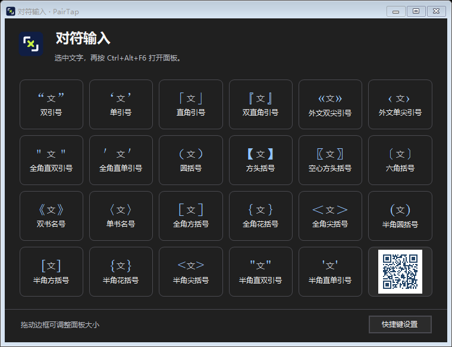

# 对符输入 PairTap

在 Windows 上选中文本，按快捷键一键在两端加上成对的引号、括号或书名号。

[下载 PairTap.exe（绿色单文件）](https://github.com/Buds-2025/PairTap/releases/latest/download/PairTap.exe) · [English](README.en.md) · [Releases](https://github.com/Buds-2025/PairTap/releases/latest)

---

## 使用方法

1. **运行**：下载并打开 `PairTap.exe`（单文件免安装，运行后常驻屏幕右下角系统托盘）。
2. **选中**：在 Word、文本编辑器或网页输入框的可编辑区域中**选中文本**。
3. **加标点**：
   - 直接按**快捷键**包裹（如 `Ctrl+Shift+'` 加双引号）；
   - 或按 `Ctrl+Alt+F6` 打开面板点击选用。

---

## 常用快捷键

平时打标点按什么键，加按一个 `Ctrl` 就是对应的对符快捷键：

| 选中的文本 | 快捷键 | 中文标点效果 | 半角标点效果 |
| :--- | :--- | :--- | :--- |
| 稍后确认 | `Ctrl+Shift+'` | `“稍后确认”` | `"稍后确认"` |
| 原文 | `Ctrl+'` | `‘原文’` | `'原文'` |
| 可选 | `Ctrl+Shift+9` 或 `Ctrl+Shift+0` | `（可选）` | `(可选)` |
| 待处理 | `Ctrl+[` 或 `Ctrl+]` | `【待处理】` | `[待处理]` |
| 备注 | `Ctrl+Shift+[` 或 `Ctrl+Shift+]` | `「备注」` | `{备注}` |
| 小王子 | `Ctrl+Shift+,` 或 `Ctrl+Shift+.` | `《小王子》` | `<小王子>` |

> **提示**：
> - 按 `Ctrl+Alt+F6` 可选用全部 23 组标点（包括各类括号、书名号、直角引号等）。
> - 单击托盘图标查看符号面板。右键选择「快捷键设置」，可修改或禁用快捷键，也可固定使用中文标点。
> - 在 Word 正文和表格中，标点会直接插入选区两侧，保留原文格式，一次撤销即可移除两侧标点。
> - 剪贴板被占用或应用禁止复制时，若可核验选区两端，原快捷键会直接插入标点。已发送的粘贴若未写入且原选区仍可核验，通知会提示再按一次原快捷键。
> - 无剪贴板写入需要编辑器公开可读、可定位的选区。检测到焦点或内容变化时，PairTap 会停止后续写入。若通知提示结果未确认，请检查原输入框。
> - 运行日志位于 `%LOCALAPPDATA%\PairTap\Logs\runtime.log`，记录应用进程名、写入方式、处理步骤、耗时和结果。选区、文档名和剪贴板内容不进入日志。

在安装了 Chrome、Word 和 PowerShell 7 的 Windows 交互会话中，退出 PairTap 和 Word 后可用 `pwsh -File VerifyRelease.ps1` 构建并运行发布检查。`-Quick` 检查构建、版本、哈希，以及输入控件和剪贴板读取超时后的恢复。`-SettingsOnly` 单独测试快捷键的冲突、保存和重启，结束后恢复原配置。`-RequireMixedDpi` 要求两台不同 DPI 的活动显示器，`-Artifact` 和 `-RequireSignature` 可用于核验已签名的发布文件。
